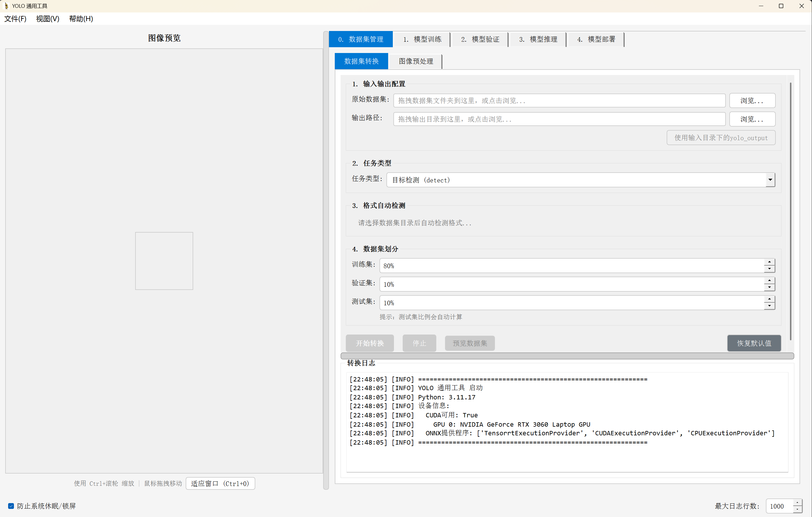

# YOLO 通用工具

基于 PyQt5 的 YOLO 模型训练与部署可视化工具，支持 YOLOv5、YOLOv8、YOLO11、YOLO26。


## 功能特性

### 核心功能

- **数据集管理**：格式转换、数据集划分、图像预处理
  - 支持格式：自动识别 VOC / COCO / YOLO / 分类文件夹结构（COCO 转换使用 Ultralytics `convert_coco()`）
  - 支持任务类型：目标检测(detect)、实例分割(segment)、姿态估计(pose)、图像分类(classify)
  - 自动生成 `data.yaml` 配置文件
  - 输出目录结构：`images/train|val|test` 和 `labels/train|val|test`
  - 图像预处理：批量缩放、去重、损坏检测，支持填充 / 裁剪两种缩放模式（关闭“保持比例”即为拉伸）

- **模型训练**：支持 7 种任务类型的 YOLO 模型训练
  - 支持模型系列：YOLOv5、YOLOv8、YOLO11、YOLO26
  - 支持任务：detect、segment、classify、pose、obb、semantic、depth
  - 自动任务-版本兼容性检查
  - 训练进度与关键指标实时显示（Epoch、mAP50 / Top-1 Acc）
  - 丰富的超参数配置（优化器、学习率调度、数据增强）

- **模型验证**：验证训练好的模型性能

- **模型推理**：支持单张图像、文件夹、视频和摄像头推理
  - 目标跟踪模式（ByteTrack/BotSORT/DeepSORT）

- **模型部署**：ONNX 格式导出与模型压缩
  - 支持 FP32 / FP16 / INT8 量化（INT8 需要校准数据集 YAML）
  - 支持动态批处理、NMS、ONNX 简化（onnxslim）
  - 导出结果验证：PT 与 ONNX 模型预测对比
  - 支持知识蒸馏（YOLOv8 / YOLO11 / YOLO26，教师与学生须同一家族）

### 版本兼容性

| 版本 | 支持任务 | 备注 |
|------|---------|------|
| YOLOv5 | detect, classify | 仅检测和分类 |
| YOLOv8 | detect, segment, classify, pose, obb | 通用模型 |
| YOLO11 | detect, segment, classify, pose, obb | 主力版本 |
| YOLO26 | detect, segment, semantic, depth, classify, pose, obb | 全任务支持 |

### 交互功能

- 拖拽操作：支持文件和文件夹拖拽
- 快捷键支持：丰富的键盘快捷键
- 实时预览：实时查看推理结果
- 缩放查看：支持图像缩放和拖拽

## 技术栈

- **Python** 3.10+
- **PyQt5** - GUI 框架
- **Ultralytics** >= 8.2.0 - YOLO 模型库
- **PyTorch** >= 2.0 - 深度学习框架
- **Matplotlib** - 数据可视化
- **OpenCV** - 图像处理
- **ONNX Runtime** - ONNX 推理

## 安装指南

### 环境要求

- Python 3.10 或更高版本
- CUDA 11.8+（推荐用于 GPU 加速）
- 显存 >= 4GB（推荐）

### 安装依赖

```bash
pip install -r requirements.txt
```

如需 GPU 支持，请安装对应版本的 PyTorch：
https://pytorch.org/get-started/locally/

### 开发环境（可选）

```bash
# 以可编辑模式安装（含 pytest/black/isort/flake8/pre-commit）
pip install -e .[dev]

# 安装 pre-commit 钩子
pre-commit install
```

### 启动应用

```bash
python main.py
```

## 使用说明

详细使用文档请参见 [docs/USER_GUIDE.md](docs/USER_GUIDE.md)。

### 快速上手

1. **数据集管理** → 转换数据集格式或预处理图像
2. **模型训练** → 选择任务、配置参数、开始训练，训练曲线与指标由 YOLO 自动输出到 `runs/` 目录
3. **模型验证** → 加载模型、选数据集、查看指标
4. **模型推理** → 加载模型、选输入源、执行推理
5. **模型部署** → 导出为 ONNX 格式

## 快捷键

| 快捷键 | 功能 |
|--------|------|
| `Ctrl+1` ~ `Ctrl+5` | 切换标签页 |
| `Ctrl+Q` | 退出程序 |
| `F1` | 显示帮助 |
| `F11` | 切换全屏 |
| `Ctrl++` / `Ctrl+-` | 放大/缩小图像 |
| `Ctrl+滚轮` | 缩放图像 |
| `Ctrl+0` | 适应窗口 |
| `Ctrl+H` | 显示/隐藏图像信息浮层 |
| `Ctrl+Shift+C` | 复制当前图片路径 |
| `Ctrl+Tab` / `Ctrl+Shift+Tab` | 切换标签页 |
| `Ctrl+N` / `Ctrl+P` | 下一张/上一张图片 |

## 项目结构

```
yolo-ui-workstation/
├── core/                    # 核心功能模块
│   ├── model_manager.py     # 模型管理器（加载、缓存、任务识别）
│   ├── inference_engine.py  # 推理引擎（GPU 调度、后处理）
│   ├── trainer.py           # 训练器（统一训练接口）
│   ├── tracking_engine.py   # 跟踪引擎（ByteTrack/BotSORT/DeepSORT）
│   └── model_exporter.py    # 模型导出器（多格式导出核心能力，当前 UI 使用 ONNX）
├── ui/                      # UI 模块
│   ├── main_window.py       # 主窗口
│   ├── tabs/                # 标签页（5 个功能页）
│   └── widgets/             # 自定义控件
├── utils/                   # 工具模块
│   ├── logger.py            # 日志管理器
│   ├── image_utils.py       # 图像处理工具
│   ├── error_handler.py     # 错误处理
│   ├── device_utils.py      # 设备管理
│   └── plot_style.py        # 图表样式
├── config/                  # 配置模块
│   └── settings.py          # 应用配置（版本矩阵、任务映射等）
├── tests/                   # 测试模块
├── docs/                    # 文档
│   └── USER_GUIDE.md        # 使用文档
├── main.py                  # 入口文件
├── requirements.txt         # 依赖列表
├── pyproject.toml           # 项目配置
└── README.md                # 项目说明
```

## 配置说明

### 任务类型与模型后缀

| 任务 | 后缀 | 示例模型名 |
|------|------|-----------|
| detect | (无) | yolo11n.pt |
| segment | -seg | yolo11n-seg.pt |
| classify | -cls | yolo11n-cls.pt |
| pose | -pose | yolo11n-pose.pt |
| semantic | -sem | yolo26n-sem.pt |
| depth | -depth | yolo26n-depth.pt |
| obb | -obb | yolo11n-obb.pt |

### 数据集转换支持

| 任务 | 源格式 | 说明 |
|------|--------|------|
| detect | YOLO + VOC + COCO | 自动识别源格式 |
| segment | COCO | 使用 use_segments=True |
| pose | COCO | 使用 use_keypoints=True |
| classify | 文件夹结构 | 仅支持数据集划分 |

**不支持的任务**：obb（旋转框）、semantic（语义分割）、depth（深度估计）

### 运行时目录

| 目录 | 用途 |
|------|------|
| `runs/` | 训练/推理输出 |
| `~/.yolo_ui_workstation/` | UI 配置持久化 |

## 测试

```bash
# 运行所有测试
python -m pytest

# 运行特定测试文件
python -m pytest tests/test_trainer.py

# 生成测试报告
python -m pytest --cov=core tests/
```

## 代码规范

```bash
flake8 .
```

## 后续开发思路

- 逐步补充 TensorRT / OpenVINO / NCNN 等多格式导出界面，并增加标注结果预览与模型对比功能
- 提供免安装的 Windows 打包版本，降低上手门槛

## 许可证

MIT License
